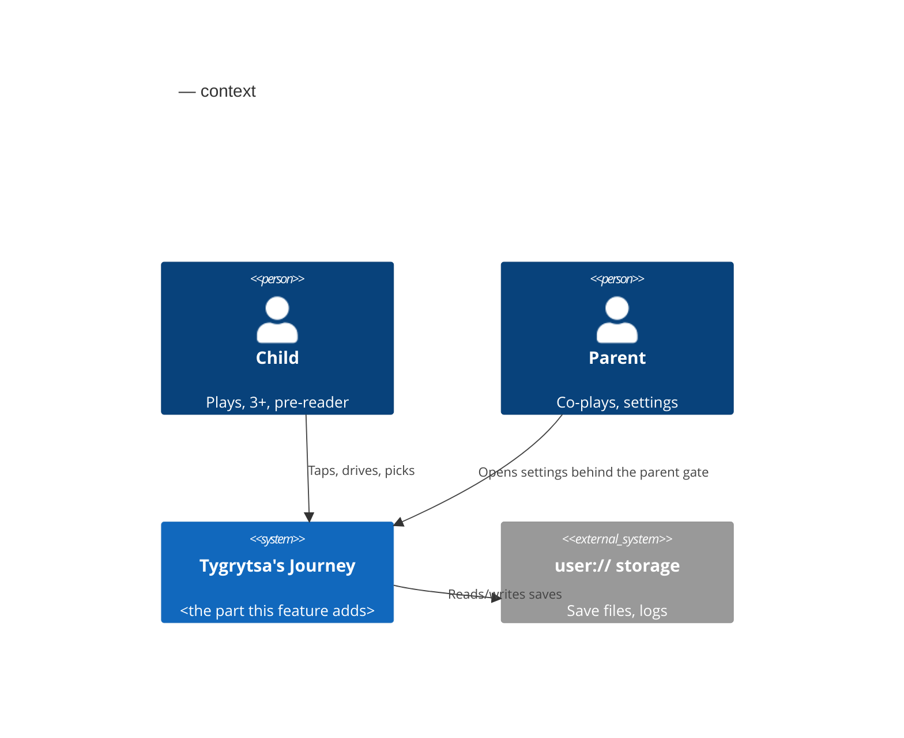
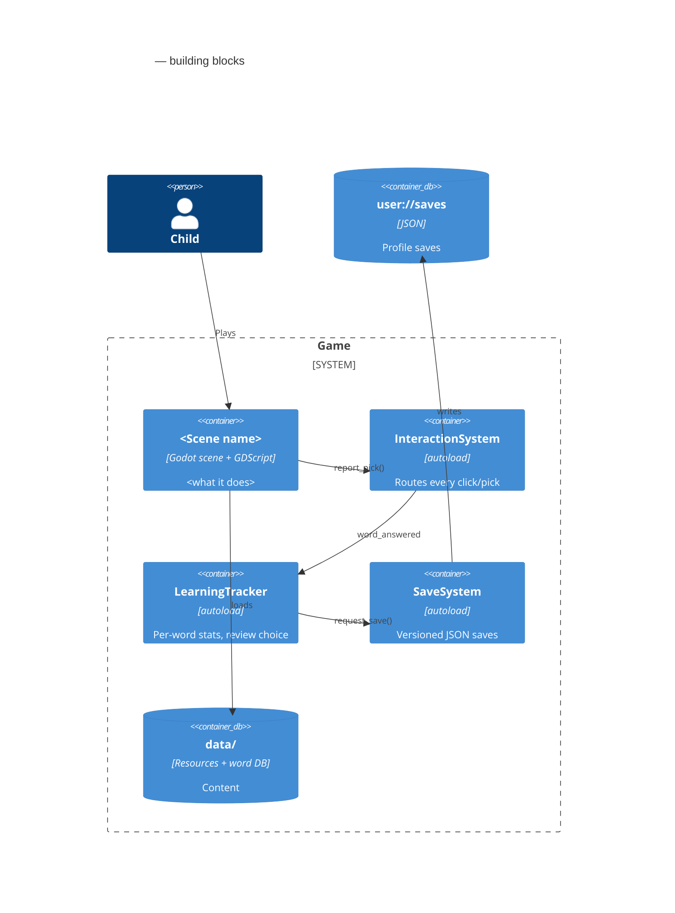
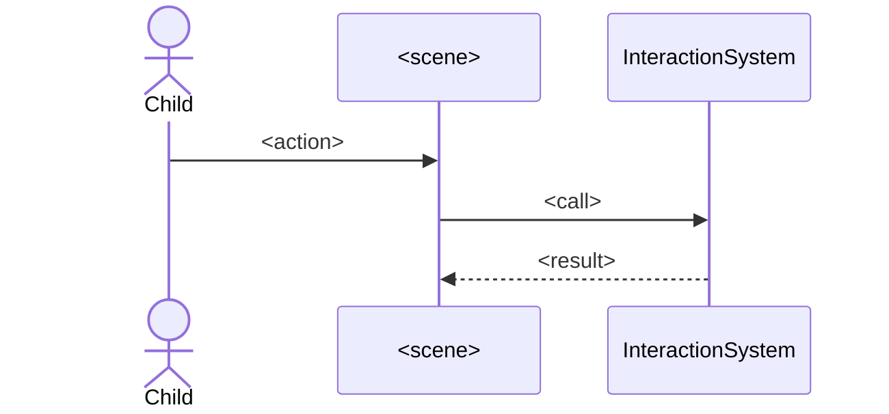

# Solution Architecture Document — <slug>

<!-- Arc42. Section not written in this mode → <!-- N/A: SAD-lite -->. Section that genuinely doesn't apply → <!-- N/A: <reason> -->. -->
<!-- C4 Context in §3, C4 Container in §5, sequences in §6. Numbers in §10 come VERBATIM from spec.md §6. -->

## 1. Introduction and goals

<!-- 1 paragraph of intent (from spec §2) + the top-3 quality goals + stakeholders.
     Quality goals for this game are usually among: the child can do it alone; never loses progress;
     ≥30 fps on the Intel MacBook; works fully offline; safe (no links, purchases, network); content is data, not code. -->

**Intent.** <What we are building and what it lets the child (or parent) do.>

**Top-3 quality goals:**

1. <e.g. "He can finish the activity alone, with hints, no reading">
2. <e.g. "No learning history is ever lost across updates">
3. <e.g. "≥30 fps on the Intel MacBook during the activity">

**Stakeholders.** Child (player, 3+) · Parent (co-player, settings, tester) · Developer (Claude + the parent)

<!-- Decision overrides (critic Override resolutions) go here as bullets. -->

## 2. Constraints

<!-- full mode. Fixed inputs, not decisions. -->

- **Engine:** Godot 4.7.x standard, GDScript (typed), Compatibility renderer
- **Addons:** <GUT, Dialogic 2, Phantom Camera, Beehave — the ones this feature uses>
- **Targets:** macOS (M4 dev, Intel MacBook 8 GB integrated GPU = performance floor), Windows later
- **Inputs:** mouse/trackpad, touch, gamepad (Machenike G5 Pro: USB, 2.4G, Bluetooth)
- **Conventions:** `docs/architecture-map.md` §Conventions
- **Safety:** offline only; no external links, ads, purchases, analytics; parent-only areas behind the parent gate

## 3. Context and scope

<!-- 2–3 sentences + the C4 Context block. Who interacts with the feature, and which existing systems it relies on. -->

<Business context in 2–3 sentences.>

## 4. Solution strategy

<!-- The FIRST decision is the areas (→ frontmatter `areas`). Then the top strategic choices — the ADR seeds.
     Typical choices: which autoload owns the new state; signal vs direct call between scene and system;
     data as Resource (.tres) vs JSON/CSV; scene composition vs inheritance; where a toddler rule lives
     (in the system or in each scene). -->

**Areas:** <core-system, ui, …> — <why>

| # | Decision | Rationale | ADR |
|---|---|---|---|
| 1 | <e.g. "LearningTracker owns per-word stats; scenes only report picks through InteractionSystem"> | <quality goal / constraint> | ADR-NNNN / inline |

## 5. Building block view

<!-- 1 paragraph + the C4 Container block: autoloads, the scenes/UI this feature adds or changes, data folders, user:// files.
     Real names from the architecture map. -->

| Block | Responsibility | New / changed | Contract |
|---|---|---|---|
| <name> | <one line> | new / changed | `contracts/autoloads.md#<name>` / — |

## 6. Runtime view

<!-- One sequenceDiagram per critical flow (template: templates/sequence.md), then the AC coverage table.
     Every §5 AC → a flow, a branch, or N/A. -->

### <flow name>

| AC | Shown by |
|---|---|
| AC-01 | <flow> step <n> |

## 7. Build and platforms

<!-- full mode. What changes in export presets, project settings, platform-specific code, asset import settings;
     the performance budget this feature consumes (draw calls, texture memory, shader cost). N/A if nothing changes. -->

## 8. Crosscutting concepts

<!-- full mode. Default = inherit the architecture map's conventions; list only overrides. -->

| Concept | Convention | Where defined |
|---|---|---|
| Input handling | all picks go through InteractionSystem | architecture map §Conventions |
| Hints / idle | hint ladder from design-system | `docs/design-system.md` |
| Audio | every instruction voiced via AudioDirector | design-system §Audio |
| Persistence | SaveSystem only; versioned; migrations | `docs/contracts/save-format.md` |
| Logging | playtest event log (timestamped picks, idle, taps) | architecture map |
| Errors | never shown to the child; logged; safe fallback | architecture map |

## 9. Architecture decisions

| # | Title | Status | Section |
|---|---|---|---|
| <NNNN> | <imperative decision, e.g. "Store per-word stats in LearningTracker, not in scenes"> | Accepted | §<N> |

ADR files: `docs/features/<slug>/adr/NNNN-<title>.md` (promoted to `docs/adr/` by `ship`).

## 10. Quality requirements

<!-- full mode. Per §1 goal: When / Then / How verified. Numbers VERBATIM from spec §6. -->

| Goal | When | Then | How verified |
|---|---|---|---|
| <e.g. performance> | <the bakery activity runs with 3 cards animating> | <≥30 fps> | <perf check on the Intel MacBook at the gate> |

## 11. Risks and technical debt

<!-- Never N/A. Deferred decisions land here with the literal `Open question` severity + owner + due. -->

| Risk / debt | Severity | Mitigation / resolve before | Owner |
|---|---|---|---|
| <e.g. "Bluetooth gamepad drops on macOS"> | medium | <USB fallback; tested at gate> | <parent> |

## 12. Glossary

<!-- full mode. Terms used here, from docs/CONTEXT.md; new ones flagged for /glossary. -->
