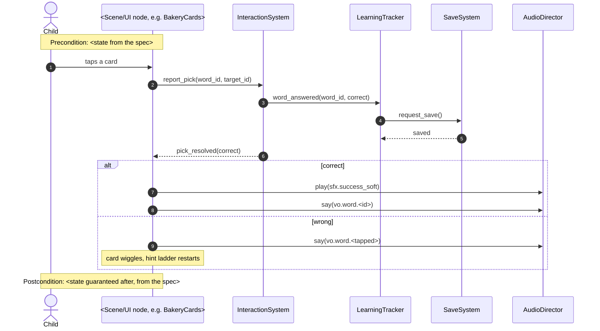
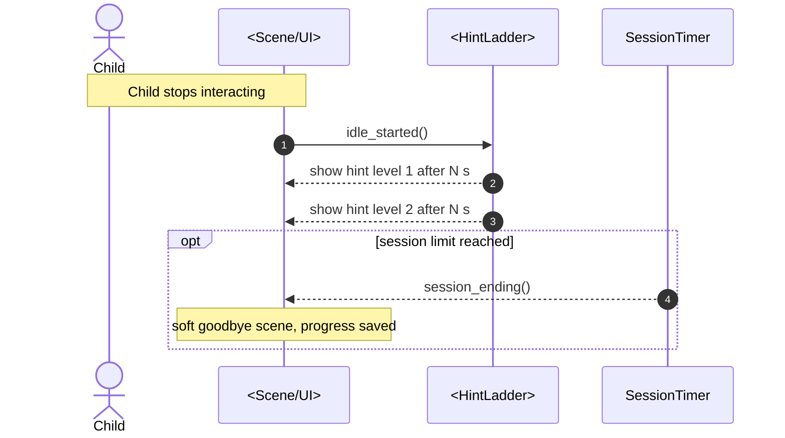

<!-- Template for design §6 (Runtime view), embedded inline in sad.md. One `### <flow>` block per critical flow. -->
<!-- Participants are REAL names from the architecture map: the child/parent, scenes, UI, autoloads, user:// files. -->
<!-- Message text is in plain words; no `;` in messages or notes (Mermaid treats it as a separator). -->

### <flow name> (US-NN, AC-NN…)

### <idle / interruption flow name>

<!-- After the flows, a coverage table: every §5 AC → flow / branch, or N/A with a reason. -->

| AC | Shown by |
|---|---|
| AC-01 | <flow> step <n> |
