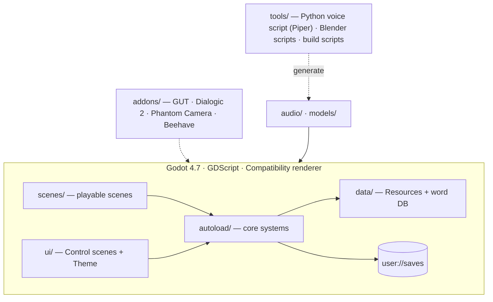

# Architecture map — Тигриця's Journey

> What the game **is** right now, tied to `reflects_commit`. Read by `specify`, `design`,
> `contracts`, `tasks`, `implement` and `review` instead of re-scanning. Refresh with `/survey`
> when the repo has moved past `reflects_commit`.

## Stack

<!-- instruction: cited. Engine, language, renderer, addons with versions, external tools. -->



| Piece | Version | Where | Notes |
|---|---|---|---|
| Godot | <4.7.x> | `project.godot` | standard build, not .NET |
| GUT | <x.y> | `addons/gut/` | unit + integration tests |
| <addon> | <x.y> | `addons/<name>/` | <…> |
| Python (voice tool) | <3.x> | `tools/voice/` | Piper voices |

## Autoloads (core systems)

<!-- instruction: one row per autoload registered in project.godot, in load order. -->

| Autoload | Script | Responsibility | Public signals | Contract |
|---|---|---|---|---|
| <InteractionSystem> | `autoload/interaction_system.gd` | <every pick goes through here> | <`pick_resolved(correct: bool)`> | `docs/contracts/autoloads.md#interactionsystem` |

## Module inventory (folders)

| Folder | What lives there | Rules |
|---|---|---|
| `autoload/` | core systems | no scene references; talk through signals and public methods |
| `scenes/` | playable scenes, one folder per scene | a scene owns its nodes; it never writes saves directly |
| `ui/` | Control scenes, `theme/*.tres` | only design-system components; tokens from the Theme |
| `data/` | `Resource` classes and `.tres` content, the word DB | content only; no logic beyond validation |
| `audio/` | generated voice, music, SFX | generated files are reproducible from `tools/` |
| `tests/` | GUT tests mirroring the source tree, `fixtures/` | one test file per script under test |
| `tools/` | voice script, Blender scripts, build scripts | not shipped with the game |
| `docs/` | specs, SADs, ADRs, contracts, playtests | — |

## Conventions (cited — the rules a new feature must match)

<!-- instruction: each convention with ONE cited example (file:line). -->

- **Typed GDScript everywhere:** `var speed: float = 4.0`, typed function signatures. (`<file:line>`)
- **Naming:** `snake_case` files and functions, `PascalCase` classes/nodes, signals in past tense (`word_answered`). (`<file:line>`)
- **Signals up, calls down:** a child node emits; a parent or a system calls. Scenes never call each other directly. (`<file:line>`)
- **All input through InteractionSystem:** scenes report picks; they don't judge them. (`<file:line>`)
- **Content is data:** words, chapters and quests live in `data/`; adding content never touches engine code. (`<file:line>`)
- **Saves only through SaveSystem**, versioned, with migrations (`docs/contracts/save-format.md`). (`<file:line>`)
- **Errors never reach the child:** `push_warning`/log + a safe fallback. (`<file:line>`)
- **Scene files:** prefer composing in code or small scenes; avoid hand-editing large `.tscn` text; keep `uid://` references intact. (`<file:line>`)
- **Tests:** GUT, `extends GutTest`, `test_<behaviour>()` names, fixtures under `tests/fixtures/`. (`<file:line>`)

## Pattern few-shots (copy these shapes)

<!-- instruction: 3–5 SHORT real excerpts (≤25 lines each) from the repo, each with its path. These are what
implement/refactorer imitate. Greenfield: write them as the target shape and mark "(target)". -->

### A core system (autoload)

```gdscript
# <path>
```

### A content Resource

```gdscript
# <path>
```

### A scene script reporting to a system

```gdscript
# <path>
```

### A GUT test

```gdscript
# <path>
```

## Data and saves

| Store | Format | Version | Contract |
|---|---|---|---|
| `user://saves/<profile>.json` | JSON | <N> | `docs/contracts/save-format.md` |
| `data/words/*` | <csv/json/tres> | — | `docs/contracts/word-db.md` |

## UI foundation

<!-- instruction: what the design system provides in code: the Theme file(s), the component scenes, their paths.
Detailed canon lives in docs/design-system.md; this section only points at the code. -->

- Theme: `ui/theme/<name>.tres`
- Components: `ui/components/<name>.tscn` — <list>

## Where things live / closest precedents

- A new activity like <X> → copy `<scene path>` and its test `<test path>`.
- A new word list → `<data path>`, validated by `<test path>`.

## Performance budget

- Floor machine: Intel MacBook, 8 GB, integrated GPU → ≥30 fps, load ≤10 s.
- <draw calls / texture memory / shader rules once measured>

## Constraints & known debt

- <version pins, addon quirks, macOS gamepad issues…>
