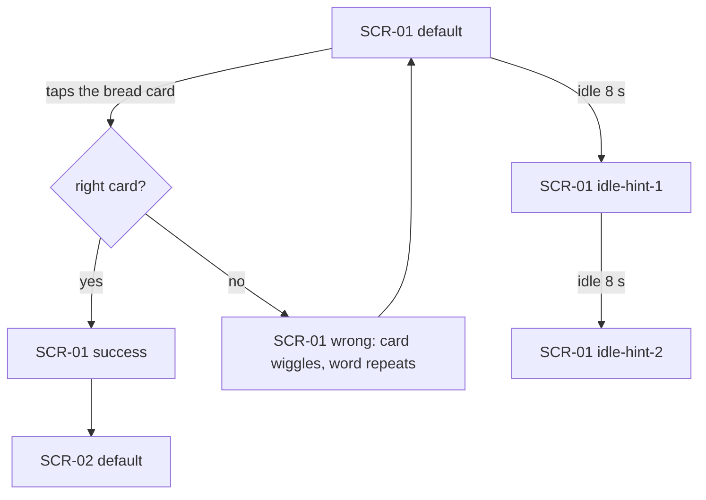

# UX flows — <feature>

> How the child (and the parent) move through this feature, and every state each scene/screen can
> be in. Read by `design`, `tasks`, `implement`, `plan-tests` and `review`.

## Input & session assumptions

<!-- instruction: what this feature assumes, defaulting to docs/design-system.md. Name any deviation + why. -->

- **Inputs:** mouse click-to-go / hold-to-follow, touch, gamepad (Machenike G5 Pro) — <per design system | deviation>
- **Hint ladder:** idle <N> s → hint 1 (voice repeat), +<N> s → hint 2 (glow), +<N> s → hint 3 (hand points) — <per design system | deviation>
- **Session:** <auto-pause on idle > N s; resume point>

## Scene / screen inventory

| ID | Scene or screen | Purpose | Entry | Exit |
|---|---|---|---|---|
| SCR-01 | <name> | <one line> | <from where> | <to where> |

## Flows

<!-- instruction: ONE flow per child/parent-facing user story. Happy path + a branch for each relevant AC
     + the toddler branches (idle, wrong, mashing, walked away). No fail states. -->

### Flow: <US-NN — name>

<one-paragraph prose account: the happy path and every branch, in plain words>

## State manifest

<!-- instruction: one table per SCR. Components ONLY from docs/design-system.md, or NEW + justification
     (the human must approve). "Heard" = a voice line id from the word DB / dialogue, or an SFX token. -->

### SCR-01 — <name>

| State | On screen (components) | Heard | Accepted input | Exits to |
|---|---|---|---|---|
| default | <PictureCard ×3, HintHand hidden> | <vo.bakery.find_bread> | tap / click / A button on a card | success / wrong |
| idle-hint-1 | <same> | <vo.bakery.find_bread (repeat)> | same | default / idle-hint-2 |
| success | <ProgressStars +1, card bounce> | <sfx.success_soft + vo.word.bread> | none for 1.5 s | SCR-02 |
| wrong | <tapped card wiggles> | <vo.word.<tapped> + vo.bakery.find_bread> | same as default | default |
| paused | <dimmed, big Play button> | <none> | any input resumes | previous state |

### New components (need approval)

| Component | Needed for | Why no existing component fits | Approved |
|---|---|---|---|
| <name> | SCR-NN <state> | <reason> | [ ] |

## AC coverage

| AC | Shown by | Notes |
|---|---|---|
| AC-01 | Flow US-01 → <node/branch> | <…> |

## Design input (not decided here)

<!-- instruction: anything a flow implies about architecture (a new autoload, a cross-scene state) — for design. -->

- <none | item>
