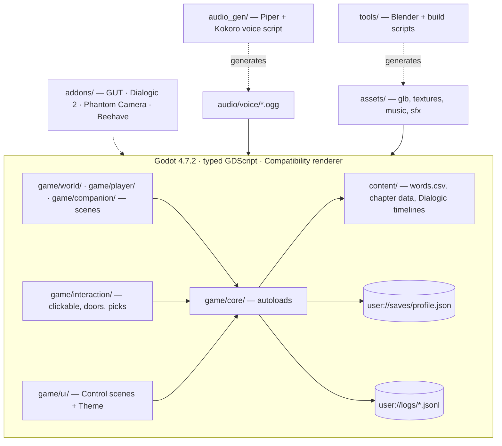

# Architecture map — Тигриця's Journey

> What the game **is** right now, tied to `reflects_commit`. Read by `specify`, `design`,
> `contracts`, `tasks`, `implement` and `review` instead of re-scanning. Refresh with `/survey`
> when the repo has moved past `reflects_commit`.
>
> **Mode: greenfield-bootstrap.** The repo has no Godot project yet. Everything below is the
> **decided foundation** (the target the skeleton and later features build to), not a scan.
> Few-shots are marked *(target)* until real code replaces them. Sources: `docs/development-plan.md`
> (Phase 0, Architecture, Project structure), `docs/game-spec.md`, `CLAUDE.md`, and the
> foundation ADRs 0001–0004 in `docs/adr/`.

## Stack



| Piece | Version | Where | Notes |
|---|---|---|---|
| Godot | 4.7.2.stable (standard, not .NET) | `/Applications/Godot.app` · `project.godot` | stay on 4.7.x; upgrade only between phases (development plan, risks) |
| Renderer | Compatibility (OpenGL 3.3) | `project.godot` | the Intel MacBook iGPU is the floor (ADR-0001) |
| GUT | 9.7.1 | `addons/gut/` | the 9.7 line is the one built for Godot 4.7's stricter return types |
| Dialogic | 2.0-alpha-20 | `addons/dialogic/` | dialogue timelines; alpha, pinned; don't upgrade mid-phase (its saves break across alphas) |
| Phantom Camera | 0.12 | `addons/phantom_camera/` | follow camera, walk ↔ drive blend |
| Beehave | 2.9.3 | `addons/beehave/` | behaviour trees for Тигриця and NPCs |
| gdtoolkit | 4.x | `pip3 --user` | `gdlint`, `gdformat` |
| Git LFS | 3.8 | `.gitattributes` | `glb png jpg ogg wav blend ttf otf` |
| Python (voice tool) | 3.13 | `audio_gen/` | Piper (Ukrainian), Kokoro (EN/ES/FR) — Phase 2 |
| Blender, OBS | installed | — | modeling scripts; playtest recordings (never in git) |

## Autoloads (core systems)

Registered in `project.godot` in this order. Rows marked *(planned)* arrive in the phase named;
their contracts are written by `/contracts` when they do.

| Autoload | Script | Responsibility | Public signals | Contract |
|---|---|---|---|---|
| EventLog | `game/core/event_log.gd` | append timestamped JSON lines for playtests (Phase 0 stub, Phase 1 full) | `event_logged(kind: StringName)` | `docs/contracts/autoloads.md#eventlog` |
| GameState | `game/core/game_state.gd` | example autoload of the skeleton; later the in-memory session state | `state_changed(key: StringName)` | `docs/contracts/autoloads.md#gamestate` |
| Speech | `game/core/speech.gd` | Phase 1 placeholder voices via OS text-to-speech (`say(text, lang)`); replaced by AudioManager | — | — |
| Sfx | `game/core/sfx.gd` | Phase 1 placeholder sound effects synthesized in code (`play(kind)`) | — | — |
| PhantomCameraManager | `addons/phantom_camera/…/phantom_camera_manager.gd` | required by Phantom Camera | — | addon |
| Settings *(planned, Ph 2)* | `game/core/settings.gd` | volume, session length, language, parent options | `setting_changed(key: StringName)` | — |
| SaveSystem *(planned, Ph 2)* | `game/core/save_system.gd` | versioned JSON per profile, autosave, migrations | `saved()`, `loaded(profile_id: String)` | `docs/contracts/save-format.md` |
| AudioManager *(planned, Ph 2)* | `game/core/audio_manager.gd` | voice by line id, music ducking, no overlap | `line_finished(line_id: StringName)` | — |
| InputRouter *(planned, Ph 1)* | `game/core/input_router.gd` | one place mapping mouse / keys / pad / touch to game intents | `intent(kind: StringName)` | — |
| InteractionSystem *(planned, Ph 1–2)* | `game/core/interaction_system.gd` | every click and card pick is judged here, then sent to the tracker | `pick_resolved(word_id: StringName, correct: bool)` | — |
| LearningTracker *(planned, Ph 2)* | `game/core/learning_tracker.gd` | per-word stats, box-based repetition | `word_due(word_id: StringName)` | — |
| QuestSystem *(planned, Ph 2)* | `game/core/quest_system.gd` | chapters and tasks from data | `task_completed(task_id: StringName)` | — |

## Module inventory (folders)

The layout follows the development plan's "Project structure and data" exactly, plus `tests/`
mirroring `game/`. This replaces the workflow template's generic `autoload/ scenes/ ui/` layout.

| Folder | What lives there | Rules |
|---|---|---|
| `game/core/` | autoloads | no scene references; talk through signals and public methods |
| `game/player/` | hero, car, camera rigs | report to systems; never write saves |
| `game/companion/` | Тигриця behaviour (Beehave) and hints | hints follow the ladder in `docs/design-system.md` |
| `game/interaction/` | clickable, password door, pick-picture, find-object | scenes report picks to InteractionSystem; they don't judge |
| `game/ui/` | Control scenes, `game/ui/theme/*.tres`, `game/ui/components/` | only design-system components; tokens from the Theme |
| `game/world/<place>/` | `ukraine_village/`, `england_town/` scenes | one folder per place |
| `game/dev/` | developer-only scenes (gamepad check) | excluded from release exports |
| `content/` | `words/words.csv`, `chapters/`, `dialogue/` | content only; no logic beyond validation |
| `assets/` | models (glb), textures, music, sfx | Git LFS |
| `audio_gen/` | voice generation script + line lists | not shipped; Python |
| `audio/voice/` | generated `.ogg` voice | Git LFS; reproducible from `audio_gen/` |
| `tests/` | GUT tests mirroring `game/` (`tests/core/test_game_state.gd`), `tests/fixtures/` | one test file per script under test |
| `tools/` | export and build scripts, Blender scripts | not shipped |
| `addons/` | the four pinned addons | vendored, never edited; excluded from lint |
| `docs/` | specs, SADs, ADRs, contracts, playtests | English |

## Conventions (the rules a new feature must match)

Greenfield: no code to cite yet. Each rule names the file that will be its first example once
`/scaffold` runs; `/survey` re-run after Phase 0 replaces these with real `file:line` anchors.

- **Typed GDScript everywhere:** `var speed: float = 4.0`, typed parameters and returns, typed arrays (`Array[StringName]`). No untyped `var`. *(first: `game/core/game_state.gd`)*
- **Naming:** `snake_case` files, functions, variables; `PascalCase` `class_name` and nodes; signals in past tense (`word_answered`); constants `UPPER_SNAKE`; ids are `StringName` (`&"apple"`). *(first: `game/core/game_state.gd`)*
- **Signals up, calls down:** a child emits; a parent or a system calls. Scenes never call each other directly. *(first: `game/dev/gamepad_check/gamepad_check.gd`)*
- **Input by action, never by key:** code reads the input map actions `move_left`, `move_right`, `move_up`, `move_down`, `use`, `horn`, `pause` (each bound to keys and gamepad once in `project.godot`). Mouse and touch pointing goes through the pointer path (touch emulates mouse). *(first: `project.godot` `[input]`)*
- **All picks through InteractionSystem:** scenes report; they don't judge. *(from Phase 1)*
- **Content is data:** words, chapters and quests live in `content/`; adding content never touches engine code (ADR-0004).
- **Saves only through SaveSystem**, versioned, with migrations (ADR-0003, `docs/contracts/save-format.md`).
- **Errors never reach the child:** `push_warning` + EventLog + a safe fallback; never `assert` in shipping paths. *(first: `game/core/event_log.gd`)*
- **Scene files:** small scenes, compose in code where reasonable; never hand-edit large `.tscn`; keep `uid://` references intact.
- **Tests are optional** (speed first; the playtest is the real test). When one is worth it, mainly a fixture save after a save-format change: GUT, `extends GutTest`, `test_<behaviour>()` names, one file per script at the mirrored path, fixtures under `tests/fixtures/`; tests never touch the real `user://saves` (use a temp dir). *(first: `tests/core/test_game_state.gd`)*
- **No network code at all.** No `HTTPRequest`, no sockets, no OS.shell_open of URLs (CLAUDE.md child-safety rule).

## Pattern few-shots (copy these shapes)

### A core system (autoload) *(target)*

```gdscript
# game/core/game_state.gd
extends Node
## In-memory session state. Systems read and write it through set_value/get_value.

signal state_changed(key: StringName)

var _values: Dictionary[StringName, Variant] = {}


func set_value(key: StringName, value: Variant) -> void:
	if _values.get(key) == value:
		return
	_values[key] = value
	state_changed.emit(key)


func get_value(key: StringName, fallback: Variant = null) -> Variant:
	return _values.get(key, fallback)
```

### A content Resource *(target, Phase 2)*

```gdscript
# game/core/word_entry.gd
class_name WordEntry
extends Resource

@export var id: StringName
@export var topic: StringName
@export var uk: String
@export var en: String
@export var model_path: String
```

### A scene script reporting to a system *(target)*

```gdscript
# game/interaction/clickable.gd
class_name Clickable
extends Area3D

signal clicked(word_id: StringName)

@export var word_id: StringName


func _input_event(_camera: Camera3D, event: InputEvent, _pos: Vector3, _normal: Vector3, _idx: int) -> void:
	if event is InputEventMouseButton and event.pressed and event.button_index == MOUSE_BUTTON_LEFT:
		clicked.emit(word_id)
		EventLog.log_event(&"click", {"word_id": word_id})
```

### A GUT test *(target)*

```gdscript
# tests/core/test_game_state.gd
extends GutTest

const GameStateScript: GDScript = preload("res://game/core/game_state.gd")

var _state: Node


func before_each() -> void:
	_state = GameStateScript.new()
	add_child_autofree(_state)


func test_set_value_emits_state_changed_once() -> void:
	watch_signals(_state)
	_state.set_value(&"chapter", 1)
	_state.set_value(&"chapter", 1)
	assert_signal_emit_count(_state, "state_changed", 1)
```

## Data and saves

| Store | Format | Version | Contract |
|---|---|---|---|
| `user://saves/<profile_id>.json` | JSON, `version` field, migration chain | 1 (first, Phase 2) | `docs/contracts/save-format.md` (Phase 2) |
| `content/words/words.csv` | CSV `id,topic,uk,en,es,fr,model` | — | `docs/contracts/word-db.md` (Phase 2) |
| `content/chapters/*.tres` | Godot `Resource` | — | `docs/contracts/content-resources.md` (Phase 2) |
| `content/dialogue/*.dtl` | Dialogic timelines | — | — |
| `user://logs/<date>-<time>.jsonl` | JSON lines `{t, kind, data}` | — | `docs/contracts/autoloads.md#eventlog` |

## UI foundation

Not built yet. `/design-system` writes `docs/design-system.md`; the code lands in:

- Theme: `game/ui/theme/main_theme.tres` (set as the project's default theme)
- Components: `game/ui/components/<name>.tscn`

## Where things live / closest precedents

- A developer-only test scene → copy `game/dev/gamepad_check/` (after `/scaffold`).
- A new autoload → copy `game/core/game_state.gd` and `tests/core/test_game_state.gd`, register it in `project.godot`, add its section to `docs/contracts/autoloads.md`.

## Performance budget

- Floor machine: Intel MacBook, 8 GB, integrated GPU, Compatibility renderer → ≥30 fps, load ≤10 s.
- Art (Miyazaki-inspired, original): toon shading with coloured shadows and rim light, hand-painted gradient textures shared across models, painted sky with drifting cloud layers, wind sway as a vertex shader on instanced grass at low density. All shader-based; no SSAO, SSR, glow-heavy or other post-processing chains; few real-time shadows (one directional light, short distance).
- Concrete numbers (draw calls, texture memory, triangle counts) are set at Gate 3 on the prologue village and recorded here.

## Constraints & known debt

- Dialogic 2 is still alpha; alpha 20 broke subsystem save state versus 19. Pin it and keep Dialogic state out of our save format (our save stores only our own data).
- GUT 9.7: doubles return typed defaults, not `null` (Godot 4.7 return-type checks).
- macOS gamepad over Bluetooth may differ from USB and the 2.4G dongle; Gate 0 tests all three with the Machenike G5 Pro, USB is the guaranteed fallback.
- macOS export is unsigned and not notarized (local play only); first launch on the Intel MacBook needs right-click → Open.
- Phase 0: the main scene is the gamepad check (`game/dev/gamepad_check/`), so Gate 0 builds show it; it moves to the title screen when one exists, and `game/dev/` is then excluded from release exports.
- Exports exclude `tests/`, `tools/`, `audio_gen/`, `docs/`, `addons/gut/` and `addons/phantom_camera/examples/` (the examples produce export errors and are dead weight).
- Format with `gdformat -l 110` so it agrees with `gdlintrc`'s `max-line-length: 110`.
- `godot` is not on PATH on the M4; commands use `/Applications/Godot.app/Contents/MacOS/Godot` (also set as `godot_bin` in `.claude/sdd.local.md`).
