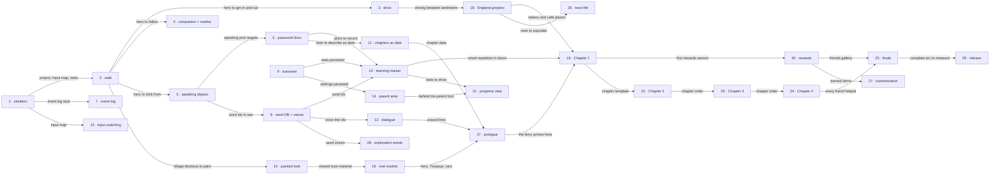

# Roadmap — Тигриця's Journey

> **A decomposition, not a promise.** The overall idea broken into incremental steps: what each
> step is, where it comes from, how big it is — or that nobody has looked at it yet — and in which
> order, phase by phase, we walk them. **No dates** (except shipped history), **no scores** —
> order is the prioritization. The *solution* for any step lives in its `docs/features/<slug>/`
> spec, not here.

## Destination

Our son plays the whole England arc, from the Ukrainian prologue to the festival, on the family Macs and a Windows PC, without reading, without getting stuck, and comes away recognizing English words for food, colours, animals and numbers.

## Steps

| # | Step | Source | Size | Status |
|---|---|---|:---:|---|
| 1 | Project skeleton: Godot project boots, tests run, builds export, gamepad check scene | `development-plan.md` §Phase 0 — Setup | M | building |
| 2 | He walks the greybox village: click to go, hold to follow, arrows, stick, with the follow camera | `development-plan.md` §Phase 1 — Greybox prototype | M | idea |
| 3 | He drives a box car: get in and out, forgiving driving, soft bounce, horn, camera blend | `development-plan.md` §Phase 1 — Greybox prototype | M | idea |
| 4 | Тигриця placeholder follows him and points the way; glowing marker; idle nudge after ~15 s | `development-plan.md` §Phase 1 — Greybox prototype | M | idea |
| 5 | Clicking an object says its name (OS text-to-speech) and shows the word briefly | `development-plan.md` §Phase 1 — Greybox prototype | S | idea |
| 6 | Greybox password door: three speaking cards, gentle wrong-pick response, opens after 2 wrong picks | `game-spec.md` §Password doors | M | idea |
| 7 | Playtest event log records every click, idle pause and card pick, ready to review next to OBS | `development-plan.md` §Phase 1 — Greybox prototype | S | idea |
| 8 | Words come from the word database with locally generated voices, played by the audio manager | `development-plan.md` §Phase 2 — Core systems and content pipeline | L | idea |
| 9 | Progress is autosaved per profile and survives closing the game at any moment | `development-plan.md` §Phase 2 — Core systems and content pipeline | L | idea |
| 10 | Doors and tasks bring back the words he struggles with (learning tracker, box-based repetition) | `game-spec.md` §Learning design | M | idea |
| 11 | Chapters, tasks and door passwords run from data files; the greybox runs on them | `development-plan.md` §Phase 2 — Core systems and content pipeline | L | idea |
| 12 | Тигриця and townspeople speak through Dialogic, each line tied to its voice file | `development-plan.md` §Phase 2 — Core systems and content pipeline | M | idea |
| 13 | Input switches seamlessly between mouse, keyboard and gamepad, with Xbox or Nintendo prompts and gentle rumble | `development-plan.md` §Phase 2 — Core systems and content pipeline | S | idea |
| 14 | Parent area behind the parent lock: name, languages, volume, and the 15-minute session timer with Тигриця's goodbye | `game-spec.md` §Parent features and profiles | L | idea |
| 15 | The village gets its painted look: toon shader, painted sky, wind in the grass, warm grading, holding 30 fps | `development-plan.md` §Phase 3 — Prologue vertical slice | L | idea |
| 16 | Hero, Тигриця and the three cars as real models; he picks his car | `development-plan.md` §Phase 3 — Prologue vertical slice | L | idea |
| 17 | The prologue plays start to finish: meet Тигриця, tutorial, the postman's "hello" and "bye", the ferry | `game-spec.md` §Story | L | idea |
| 18 | The English town is laid out in greybox with every landmark | `development-plan.md` §Phase 4 — Chapter 1: the bakery | M | idea |
| 19 | Chapter 1: he finds the baker's ingredients and learns food words and counting, with bakery and café doors | `development-plan.md` §Phase 4 — Chapter 1: the bakery | L | idea |
| 20 | Rewards: the map unlocks, souvenirs replay their word, the friends gallery fills | `game-spec.md` §Gameplay | M | idea |
| 21 | Parent progress view: words heard, recognized, and struggled with | `game-spec.md` §Parent features and profiles | M | idea |
| 22 | Chapter 2: the toy maker's balloons, colours with shapes and patterns, park and harbour | `development-plan.md` §Phase 5 — England chapters 2–4 and the finale | L | idea |
| 23 | Chapter 3: the escaped farm animals, their sounds and names | `development-plan.md` §Phase 5 — England chapters 2–4 and the finale | L | idea |
| 24 | Chapter 4: the stopped clock tower, numbers 1–10 | `development-plan.md` §Phase 5 — England chapters 2–4 and the finale | L | idea |
| 25 | Finale: the festival with every friend he helped | `game-spec.md` §Story | M | idea |
| 26 | Town life → see [Not yet specified](#not-yet-specified) | `game-spec.md` §Gameplay | fog | idea |
| 27 | Customization → see [Not yet specified](#not-yet-specified) | `game-spec.md` §Gameplay | fog | idea |
| 28 | Free exploration words: hidden collectibles and the car's words (stop, go, left, right, horn, lights) | `game-spec.md` §Learning design | M | idea |
| 29 | Release: performance pass on the Intel MacBook and scripted macOS + Windows builds with install notes | `development-plan.md` §Phase 6 — Polish and release builds | M | idea |

## Not yet specified

| Area | What we'd have to learn | Blocks | How it gets sharpened |
|---|---|:---:|---|
| Town life | How many walkers and animals, how traffic "always stops for him", whether day/night and weather are visual only or change tasks, and what it costs on the Intel MacBook | 26 | recon after Gate 4 with the real town, plus a perf prototype |
| Customization | Which items (paint shop colours, outfits, hats, stickers, horns), how they are earned, and whether they show up on the hero model and the car without new art per item | 27 | a short conversation with the parents after Chapter 1, then a spec |

## Out of scope

- Spain and France arcs — after Gate 6 (development plan, Phase 6 gate).
- Steam release and GodotSteam — only if the family decides to publish.
- Speech recognition for say-it-back — optional, later; say-it-back stays praise-only.
- Multiple player profiles in the UI — the save format supports them, the UI ships with one.
- Anything online: network, analytics, ads, purchases (CLAUDE.md child-safety rule).

## Open decisions

| # | Question | Type | Owner | Blocks |
|---|---|:---:|:---:|:---:|
| D1 | Which parent-lock method: a held key combination, a hold-for-3-seconds corner button, or an adult arithmetic question? | grilling | human | 14 |
| D2 | What is the child's name and how is it pronounced, for the narrator lines? | task | human | 17 |
| D3 | The hero photo or drawing for the model | task | human | 16 |
| D4 | Names for the English friends (baker, toy maker, farmer, clockmaker) | grilling | human | 19 |
| D5 | Is touch or mouse the primary input, decided from the Gate 1 touchscreen trial? | prototype | human | 13 |
| D6 | Does Piper's Ukrainian voice sound right, or do the parents record the narration? | prototype | human | 8 |
| D8 | Run the gamepad check across USB, dongle and Bluetooth once the gamepad is bought | task | human | 13 |
| D7 | Does the painted look (toon shader, sky, grass) hold 30 fps on the Intel MacBook, and at what grass density? | prototype | agent | 15 |

## Decisions so far

- Godot 4.7, typed GDScript, Compatibility renderer → [`docs/adr/0001-use-godot-4-7-gdscript-compatibility-renderer.md`](adr/0001-use-godot-4-7-gdscript-compatibility-renderer.md)
- Core systems are autoloads with signal contracts → [`docs/adr/0002-core-systems-as-autoloads-with-signal-contracts.md`](adr/0002-core-systems-as-autoloads-with-signal-contracts.md)
- Saves are versioned JSON per profile with migrations → [`docs/adr/0003-versioned-json-saves-with-migration-chain.md`](adr/0003-versioned-json-saves-with-migration-chain.md)
- Content is data: CSV word DB, Resource chapters → [`docs/adr/0004-content-as-data-resources-and-word-db.md`](adr/0004-content-as-data-resources-and-word-db.md)
- Greybox first, systems second, real art third; first playable target is Gate 1 → [`docs/development-plan.md`](development-plan.md)
- 15-minute default session, co-play optional → [`docs/development-plan.md`](development-plan.md)
- Toddler UI canon, hint ladder and components → [`docs/design-system.md`](design-system.md)

## Dependency graph

## Build order

### Phase 0: Setup

1. Project skeleton (#1)

**Exit gate:** a test build opens on the Intel MacBook. The gamepad half (the check scene registers every button of the Machenike G5 Pro over USB, the 2.4G dongle and Bluetooth) is **deferred until the gamepad is bought**; until then mouse and keyboard are the primary input.

### Phase 1: Greybox prototype

1. He walks the greybox village (#2)
2. He drives a box car (#3)
3. Тигриця placeholder, marker and idle nudge (#4)
4. Clicking an object says its name (#5)
5. Greybox password door (#6)
6. Playtest event log (#7)

**Exit gate:** our son plays about 10 minutes, recorded; he drives to the marker and opens the door with little or no help; we also try a touchscreen and settle D5.

### Phase 2: Core systems and content pipeline

1. Input switching with prompts and rumble (#13)
2. Words from the word database with generated voices (#8)
3. Autosave per profile (#9)
4. Learning tracker brings back struggling words (#10)
5. Chapters, tasks and passwords as data (#11)
6. Dialogue through Dialogic (#12)
7. Parent area and session timer (#14)

**Exit gate:** every system has passing GUT tests, the greybox runs on the new systems, and the prologue's voice lines are generated by the script.

### Phase 3: Prologue vertical slice

1. The painted look (#15)
2. Real models and the car choice (#16)
3. The prologue start to finish (#17)

**Exit gate:** the prologue plays start to finish on the Intel MacBook at 30 fps or more; our son plays it, recorded; we sign off the art direction.

### Phase 4: Chapter 1, the bakery

1. English town greybox (#18)
2. Chapter 1, the bakery (#19)
3. Rewards (#20)
4. Parent progress view (#21)

**Exit gate:** our son finishes Chapter 1 on his own over one or two sessions, and after a few days recognizes some food words, measured against the baseline taken before he played.

### Phase 5: England chapters 2–4 and the finale

1. Chapter 2, colours (#22), after a quick colour-vision check
2. Chapter 3, animals (#23)
3. Chapter 4, numbers (#24)
4. Free exploration words (#28)
5. Finale, the festival (#25)

Town life (#26) and customization (#27) join this phase once their recon gives them a size.

**Exit gate:** the whole England arc plays from the prologue to the festival with no blocking bugs, with a short recorded playtest after each chapter.

### Phase 6: Polish and release builds

1. Release (#29)

**Exit gate:** stable builds on both Macs and one Windows PC.

## Shipped

| Step | Shipped | Link |
|---|---|---|
